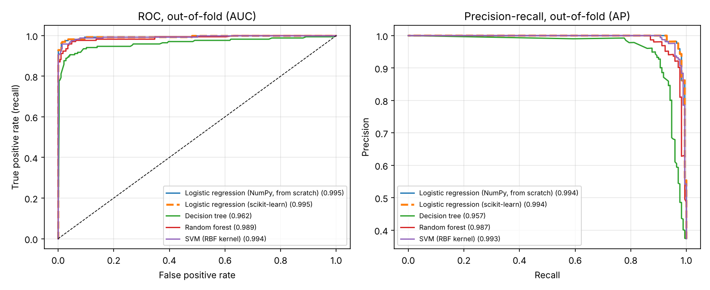

# Breast-cancer diagnosis pipeline (WDBC)

**I wrote logistic regression from scratch in NumPy, and on patients it never saw it catches 41 of 42 malignant tumours (recall 0.976, ROC-AUC 0.998). It matches scikit-learn exactly and runs behind a tested REST API.**



## Why I built this

In my MSc *Machine Learning Algorithms* course (CSCI 5740), I explored this dataset and derived gradient descent for linear regression by hand in Octave. Those exercises stopped at "the cost went down for 5 epochs." I wanted to carry the same ideas all the way to something a team could actually run: a classifier instead of a regression, a model that trains until it converges, a fair comparison against standard models, a decision rule chosen for patient safety, and code that is packaged, tested and served as an API.

> This is a portfolio project on a public teaching dataset. It is not a medical device and must not be used for clinical decisions.

## What I found

I compared five models with 5-fold cross-validation, repeated 3 times, on the 455 training patients:

| Model | CV ROC-AUC (mean ± sd) | CV recall | CV precision |
| --- | --- | --- | --- |
| **My logistic regression (NumPy, from scratch)** | **0.9955 ± 0.0050** | 0.947 | 0.982 |
| scikit-learn logistic regression (same objective) | 0.9955 ± 0.0050 | 0.947 | 0.982 |
| SVM (RBF kernel) | 0.9949 ± 0.0054 | 0.957 | 0.969 |
| Random forest | 0.9899 ± 0.0079 | 0.925 | 0.955 |
| Decision tree (depth 4) | 0.9023 ± 0.0537 | 0.875 | 0.917 |

My from-scratch model ties scikit-learn for first place, and when results tie I deploy the simpler model. Once the features are standardised, benign and malignant tumours are almost separable by a straight line, so the extra flexibility of forests and SVMs buys nothing.

The default decision threshold of 0.5 treats a missed cancer and a false alarm as equally bad, and they aren't. So I picked the highest threshold that still catches at least 98% of cancers in cross-validation: 0.27. I then scored the 114 held-out patients (42 malignant) once, at the very end:

| Threshold | Recall | Precision | Missed cancers | False alarms |
| --- | --- | --- | --- | --- |
| 0.50 (default) | 0.952 | 1.000 | 2 | 0 |
| **0.27 (my choice)** | **0.976** | 0.932 | **1** | 3 |

Lowering the threshold traded 3 extra follow-up checks for one fewer missed cancer, which is the trade I wanted.

More detail: [reports/results.md](reports/results.md) (every table and chart) · [reports/eda_summary.md](reports/eda_summary.md) (exploratory analysis) · [HOW_IT_WORKS.md](HOW_IT_WORKS.md) (the maths and design decisions) · [MODEL_CARD.md](MODEL_CARD.md) (limitations).

## How I made sure it's right

- **Gradient check.** I derived the gradient of the cross-entropy loss by hand, and a test compares it with a numerical finite-difference estimate to five significant digits.
- **Same answer as scikit-learn.** I set scikit-learn's solver to the identical objective; the coefficients agree.
- **Guaranteed convergence.** The step size is 1/L, computed from the data, so the cost provably never goes up; a test checks every iteration. Training stops on convergence (1,611 steps), not after a fixed number of epochs.
- **No leakage.** The test set is split off first and used once. Scaling is refit inside every cross-validation fold. The threshold comes from out-of-fold predictions. I also dropped the patient-ID column, which my original class script had left in as a feature.
- **40 automated tests**, run on every push by GitHub Actions along with a full training run and a Docker smoke test.

## Project layout

```
configs/config.yaml        every setting in one place (split, CV, learning rate, L2, recall target)
data/raw/                  wdbc.data + wdbc.names (UCI Machine Learning Repository)
src/wdbc/
  data.py                  loads and validates the data (fails loudly on a bad file), stratified split
  preprocessing.py         my z-score scaler, a Python port of my Octave class code
  logistic_scratch.py      my logistic regression, trained by gradient descent
  models.py                the 5 candidate models
  evaluate.py              metrics, repeated cross-validation, threshold choice, plots
  eda.py                   exploratory analysis
  train.py                 runs the whole pipeline end to end
  predict.py               loads the model, checks input, flags unusual values
  api.py                   FastAPI web service
  tracking.py              logs each run (MLflow if installed, JSON otherwise)
tests/                     40 tests
examples/                  a sample API request and a small CSV to score
coursework/                the Octave class scripts this project grew from
```

## Run it yourself

You need Python 3.10 or newer.

```bash
python -m venv .venv
source .venv/bin/activate            # Windows PowerShell: .venv\Scripts\Activate.ps1
pip install -e ".[api,dev]"

python -m wdbc.eda                   # exploratory analysis -> reports/
python -m wdbc.train                 # full pipeline, about 20 seconds -> models/, reports/results.md
pytest -q                            # all 40 tests
python -m wdbc.predict examples/samples.csv
uvicorn wdbc.api:app --reload        # then open http://127.0.0.1:8000/docs
```

Try the API from a second terminal:

```bash
curl -X POST http://127.0.0.1:8000/predict -H "Content-Type: application/json" -d @examples/sample_request.json
# {"probability_malignant": 0.999996, "prediction": "malignant", "threshold": 0.2665, ...}
```

Or with Docker (it trains the model during the build, then serves it):

```bash
docker build -t wdbc-api .
docker run -p 8000:8000 wdbc-api
```

## What I'd do next

- Tune the regularisation strength and the recall target with nested cross-validation.
- Add SHAP or permutation importance to explain individual predictions.
- Add a calibration plot to show whether a predicted 30% really means 30%.
- Deploy the container publicly so anyone can try the API in a browser.

## Data

Wolberg, W., Mangasarian, O., Street, N., and Street, W. (1993). *Breast Cancer Wisconsin (Diagnostic)*. UCI Machine Learning Repository. 569 fine-needle-aspirate samples (357 benign, 212 malignant), each described by 30 measurements of cell nuclei.

## Author

**[Your Name]**, MSc Computer Science, New Mexico Highlands University · [LinkedIn](https://www.linkedin.com/in/your-profile) · [your.email@example.com](mailto:your.email@example.com)
