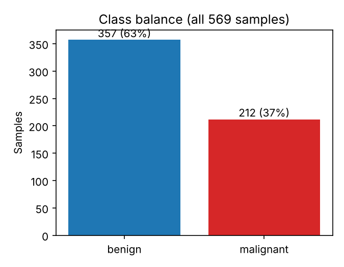
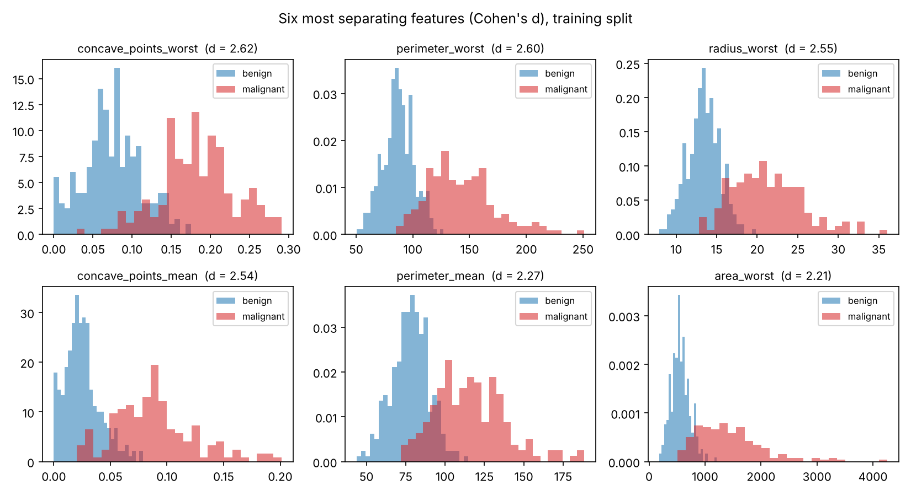
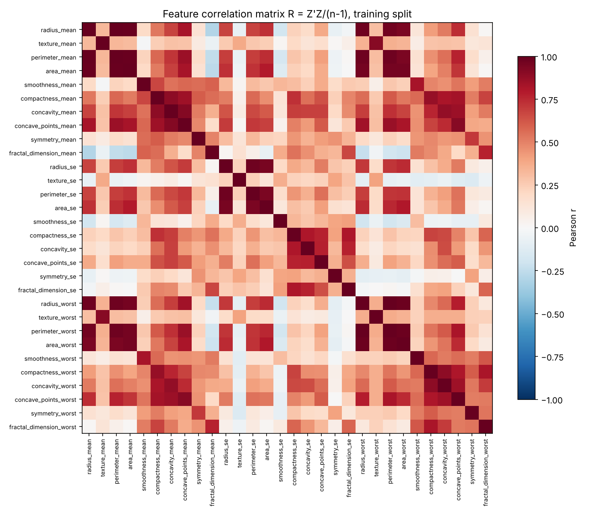

# EDA summary (generated by `python -m wdbc.eda`)

- Samples: 569  |  features: 30
- Benign: 357  |  malignant: 212
- Always-predict-benign accuracy: 62.7% (the bar every model must clear)

## Features that best separate the classes (Cohen's d, training split)

| feature | d |
| --- | --- |
| concave_points_worst | 2.62 |
| perimeter_worst | 2.60 |
| radius_worst | 2.55 |
| concave_points_mean | 2.54 |
| perimeter_mean | 2.27 |
| area_worst | 2.21 |

## Weakest features (|d|)

| feature | abs d |
| --- | --- |
| fractal_dimension_mean | 0.01 |
| symmetry_se | 0.01 |
| texture_se | 0.01 |
| smoothness_se | 0.12 |
| fractal_dimension_se | 0.15 |

## Nearly duplicate features: 15 pairs with |r| >= 0.95

| feature a | feature b | r |
| --- | --- | --- |
| radius_mean | perimeter_mean | 0.998 |
| radius_worst | perimeter_worst | 0.994 |
| radius_mean | area_mean | 0.987 |
| perimeter_mean | area_mean | 0.986 |
| radius_worst | area_worst | 0.983 |
| perimeter_worst | area_worst | 0.977 |
| radius_se | perimeter_se | 0.975 |
| perimeter_mean | perimeter_worst | 0.970 |
| perimeter_mean | radius_worst | 0.969 |
| radius_mean | radius_worst | 0.969 |
| radius_mean | perimeter_worst | 0.964 |
| area_mean | radius_worst | 0.961 |
| area_mean | area_worst | 0.958 |
| area_mean | perimeter_worst | 0.957 |
| radius_se | area_se | 0.952 |

Radius, perimeter and area are geometrically linked (perimeter ~ 2*pi*r, area ~ pi*r^2), so they carry almost the same information. Regularisation (the L2 term) keeps logistic regression stable despite this collinearity.

