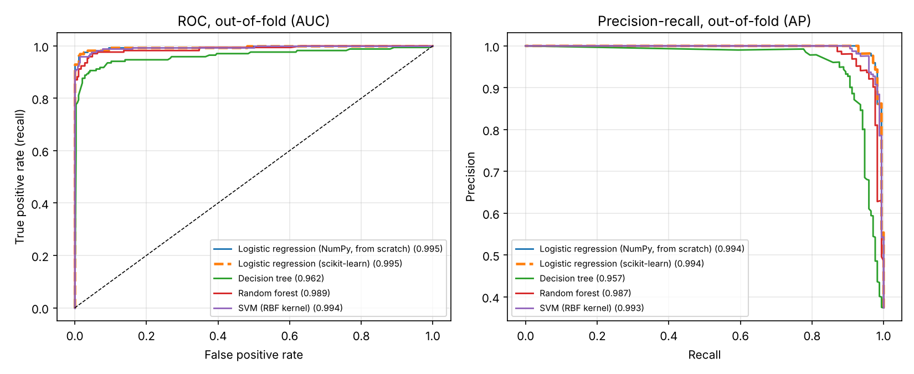
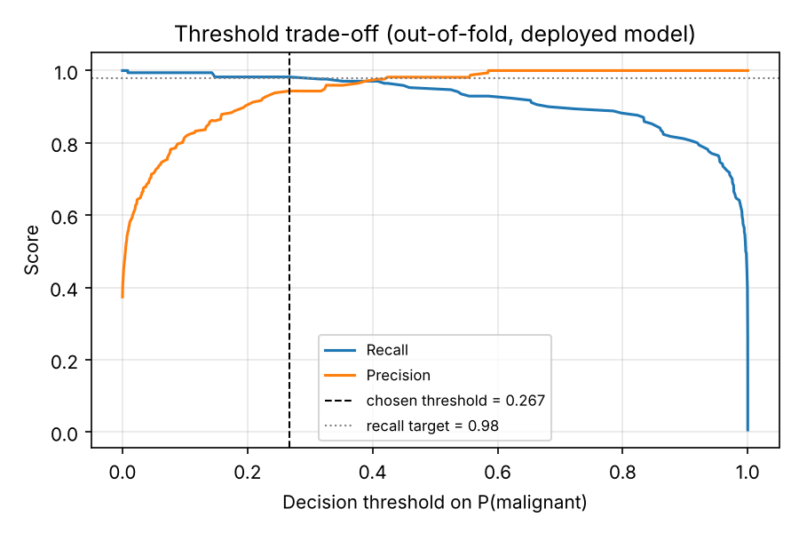
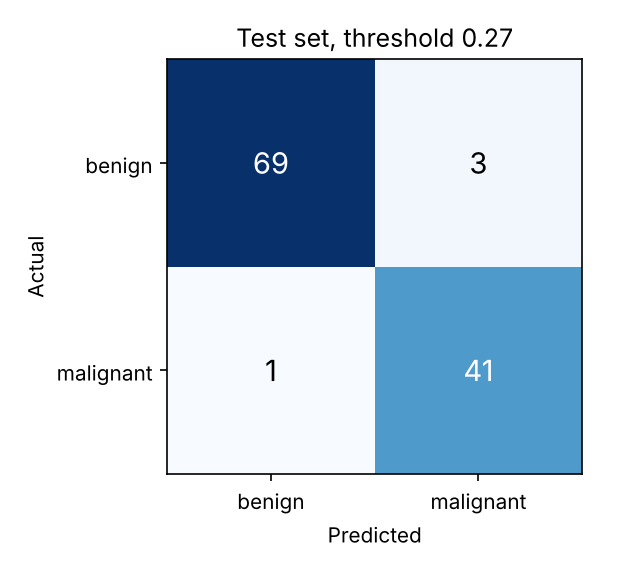
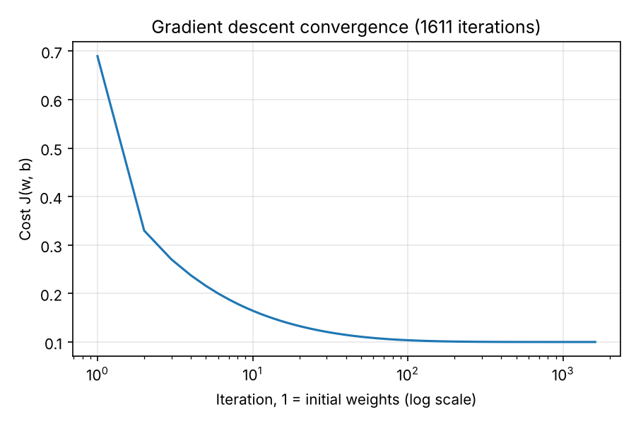

# Results (generated by `python -m wdbc.train`)

## Cross-validation on the training set (5-fold x 3 repeats, threshold 0.5)

| Model | ROC-AUC (mean ± sd) | PR-AUC | Recall | Precision | Accuracy |
| --- | --- | --- | --- | --- | --- |
| Logistic regression (NumPy, from scratch) | 0.9955 ± 0.0050 | 0.9944 | 0.947 | 0.982 | 0.974 |
| Logistic regression (scikit-learn) | 0.9955 ± 0.0050 | 0.9944 | 0.947 | 0.982 | 0.974 |
| Decision tree | 0.9023 ± 0.0537 | 0.8656 | 0.875 | 0.917 | 0.922 |
| Random forest | 0.9899 ± 0.0079 | 0.9878 | 0.925 | 0.955 | 0.955 |
| SVM (RBF kernel) | 0.9949 ± 0.0054 | 0.9935 | 0.957 | 0.969 | 0.972 |

**Deployed:** Logistic regression (NumPy, from scratch). Rule: highest mean CV ROC-AUC; models within 0.002 of the best count as tied, and the simplest tied model is chosen.

**Decision threshold:** 0.2665, the highest threshold whose out-of-fold recall is at least 0.98.

## Held-out test set (114 samples, used once)

| Threshold | Recall | Precision | Specificity | F1 | ROC-AUC | Missed cancers (FN) | False alarms (FP) |
| --- | --- | --- | --- | --- | --- | --- | --- |
| 0.500 | 0.952 | 1.000 | 1.000 | 0.976 | 0.9977 | 2 | 0 |
| 0.267 | 0.976 | 0.932 | 0.958 | 0.953 | 0.9977 | 1 | 3 |

### Every candidate on the test set (threshold 0.5, for reference only)

The deployed model was chosen from cross-validation, not from this table.

| Model | ROC-AUC | Recall | Precision | Accuracy | FN | FP |
| --- | --- | --- | --- | --- | --- | --- |
| Logistic regression (NumPy, from scratch) | 0.9977 | 0.952 | 1.000 | 0.982 | 2 | 0 |
| Logistic regression (scikit-learn) | 0.9977 | 0.952 | 1.000 | 0.982 | 2 | 0 |
| Decision tree | 0.8770 | 0.810 | 0.944 | 0.912 | 8 | 2 |
| Random forest | 0.9944 | 0.929 | 1.000 | 0.974 | 3 | 0 |
| SVM (RBF kernel) | 0.9947 | 0.952 | 0.976 | 0.974 | 2 | 1 |

## From-scratch gradient descent

- Iterations: 1611 (converged: True, tol = 1e-10)
- Final cost J = 0.10015

